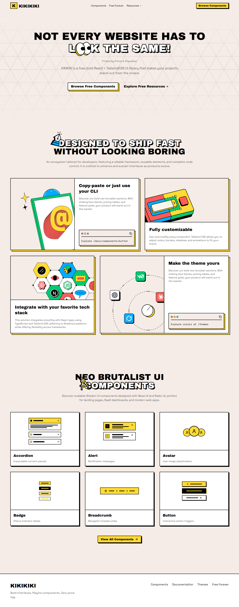

# KIKIKIKI

A neobrutalist UI component showcase built with Next.js, React, TypeScript, and Tailwind CSS, featuring component documentation and customizable themes.

Maintained by **Prince K Chaudhari**, KIKIKIKI is intended for developers exploring bold interface patterns, interactive component examples, and theme customization. Public browsing is free and requires no account.

[Getting started](#getting-started) · [Project structure](#project-structure) · [Deployment](#deployment) · [License](#license)

<details>
<summary>Homepage preview</summary>



*Homepage overview; minor navigation and copy details may differ from the latest version.*

</details>

## Features

- **Component previews:** explore interactive examples of buttons, inputs, cards, navigation, feedback elements, and charts.
- **Technical documentation:** inspect usage examples, manual dependency instructions, and component source.
- **Theme customization:** preview color palettes across interface elements and charts.
- **Responsive layouts:** browse the showcase and documentation on desktop and mobile.
- **Public access:** explore components and resources without registration, login, or payment.

## Technology stack

| Technology | Role |
| --- | --- |
| Next.js 16.2.2 | Application framework and App Router |
| React 19.2.4 | Component rendering and interaction |
| TypeScript | Typed application and component code |
| Tailwind CSS 4 | Styling and theme utilities |
| Base UI, Radix UI, and Headless UI | Interface primitives |
| Velite | MDX documentation processing |
| Recharts | Chart examples |
| Vercel | Deployment configuration, Analytics, and Speed Insights integrations |

## Requirements

- Node.js 22 LTS, recommended for local development.
- pnpm **9.15.3**, as specified in `package.json`.
- Git for cloning the repository.

Dependency installation and production builds require network access. The application uses Google fonts through `next/font`, so builds must be able to retrieve those fonts.

## Getting started

Clone the repository and install its locked dependencies:

```sh
git clone https://github.com/PrinceKChaudhari/KiKiKiKi.git
cd KiKiKiKi
pnpm install --frozen-lockfile
pnpm dev
```

Open [localhost:3000](http://localhost:3000). The development command runs the documentation watcher and Next.js development server together.

No authentication backend, database, or payment configuration is required for the public showcase.

### Explore the website

| Local route | Content |
| --- | --- |
| `/` | Homepage and featured components |
| `/docs` | Documentation introduction |
| `/docs/install` | Project setup guide |
| `/docs/components` | Component index |
| `/docs/components/button` | Button examples and source |
| `/themes` | Theme previews and customization |
| `/pricing` | Free resources overview |

For example, visit `/docs/components/button` to inspect the button implementation and its manual dependency instructions. Existing `components/retroui` paths are retained for import compatibility; they are internal directory names, not an account or registry setup requirement.

## Configuration

The public showcase can run locally without an environment file.

| Variable | Required | Purpose and default behavior |
| --- | --- | --- |
| `NEXT_PUBLIC_SITE_URL` | No | Public site origin used for sitemap and robots metadata. Takes precedence over deployment URLs. |
| `GITHUB_TOKEN` | No | Optional GitHub token used by the component RSS integration. Not needed to browse components or docs. |

On Vercel, the site origin falls back to `VERCEL_PROJECT_PRODUCTION_URL`, then `VERCEL_URL`. Outside Vercel, it defaults to `http://localhost:3000`.

To set an explicit production origin, create an untracked `.env.local` file:

```dotenv
NEXT_PUBLIC_SITE_URL=https://your-domain.example
```

Replace the example with your actual HTTPS origin. Keep tokens and credentials out of the repository; private credentials must never use a `NEXT_PUBLIC_` prefix.

## Available commands

| Command | Purpose |
| --- | --- |
| `pnpm dev` | Run the content watcher and application in development |
| `pnpm build:content` | Generate documentation with Velite |
| `pnpm build` | Generate documentation and create a Next.js production build |
| `pnpm start` | Serve an existing production build |
| `pnpm lint` | Run the configured ESLint checks |
| `pnpm registry:build` | Generate registry artifacts from the repository configuration |

Run `pnpm build` successfully before using `pnpm start`. Registry generation is a maintenance command; it does not publish a hosted KIKIKIKI registry.

## Project structure

```text
app/                   Application routes, layouts, and styles
components/            Shared website components
  retroui/             Component implementations
config/                Navigation, component, and theme configuration
content/docs/          MDX documentation
contexts/              Theme context
hooks/                 Shared React hooks
lib/                   Utilities and site metadata helpers
preview/               Component and chart examples
public/                Static images and registry assets
docs/images/           Repository documentation screenshots
velite.config.ts       Documentation processing configuration
vercel.json            Vercel install and build settings
```

Edit component documentation in `content/docs`, examples in `preview`, and navigation in `config/navigation.ts`. Generated `.velite` content is not edited directly.

## Deployment

### Vercel

1. Import [PrinceKChaudhari/KiKiKiKi](https://github.com/PrinceKChaudhari/KiKiKiKi) into Vercel.
2. Select the `main` branch and the repository root as the Root Directory.
3. Select the **Next.js** framework preset.
4. Use the commands defined in [vercel.json](./vercel.json):
   - Install: `pnpm install --frozen-lockfile`
   - Build: `pnpm build`
5. Leave the Output Directory at its Next.js default.
6. Optionally configure `NEXT_PUBLIC_SITE_URL` with your production HTTPS origin, then deploy.

For a local production check:

```sh
pnpm build
pnpm start
```

Cloudflare-specific scripts and configuration are retained in the repository. They are separate from the Vercel deployment flow above.

## Scope and limitations

KIKIKIKI provides a public component showcase, documentation, and theme previews. It does not provide accounts, subscriptions, premium downloads, or a dedicated KIKIKIKI CLI registry or MCP service.

Some examples reference external assets or packages. Free access to the website is separate from permission to reuse source code; consult the license files before copying implementations.

## Verification

Before submitting changes, run:

```sh
pnpm lint
pnpm build
git diff --check
```

A complete local production build and lint run were not performed for this documentation update. No automated application test suite is currently configured in `package.json`.

## Contributing

Read [CONTRIBUTING.md](./CONTRIBUTING.md) before proposing changes. Open an issue to discuss substantial work, explain the intended behavior, and report the checks performed. Preserve applicable third-party notices.

## License

Original KIKIKIKI additions are subject to the [KIKIKIKI Proprietary License](./LICENCE.md). Inherited source code retains its original MIT terms and required copyright and permission notice in [THIRD_PARTY_NOTICES.md](./THIRD_PARTY_NOTICES.md). Dependencies retain their respective licenses.

Public repository access and free website browsing do not grant permission to reuse proprietary additions.

## Contact

For bug reports, documentation corrections, and feature proposals, use [GitHub Issues](https://github.com/PrinceKChaudhari/KiKiKiKi/issues). Include the affected route, reproduction steps, and relevant screenshots or logs. Do not include credentials or personal information.
